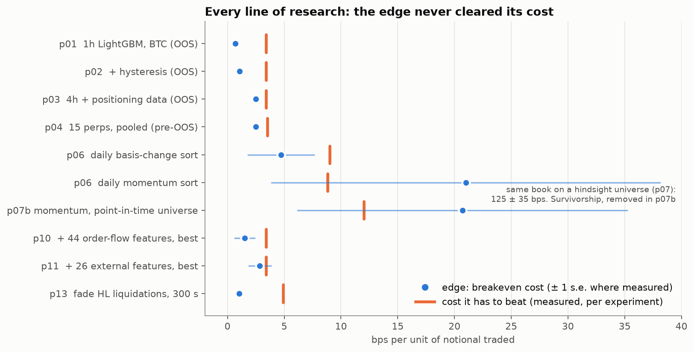
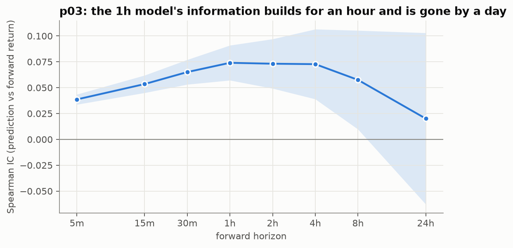
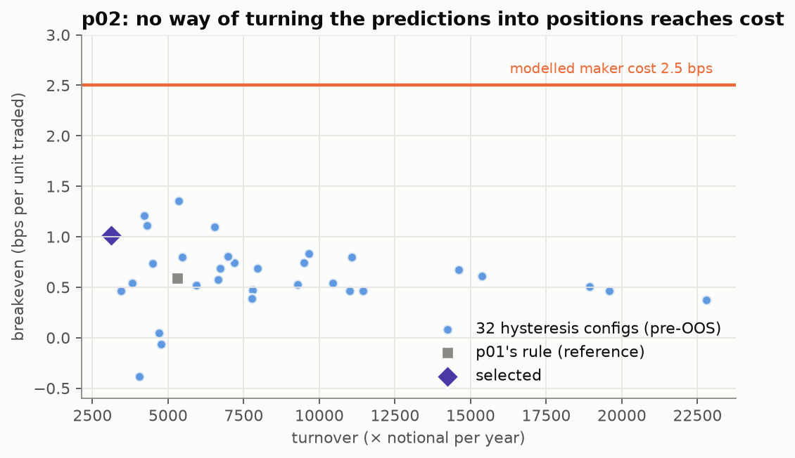
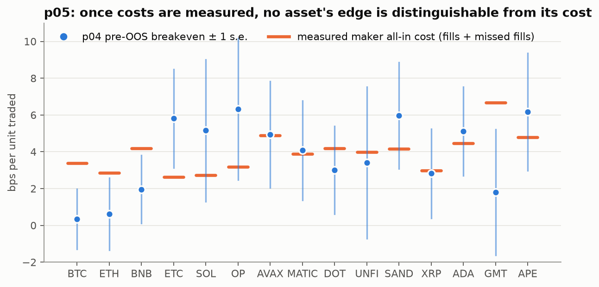
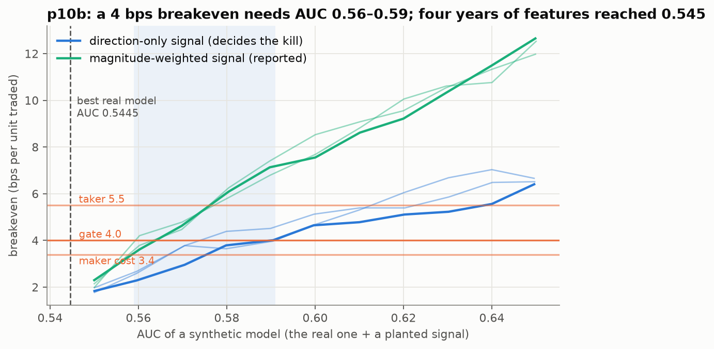
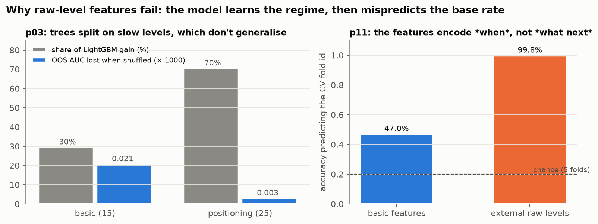
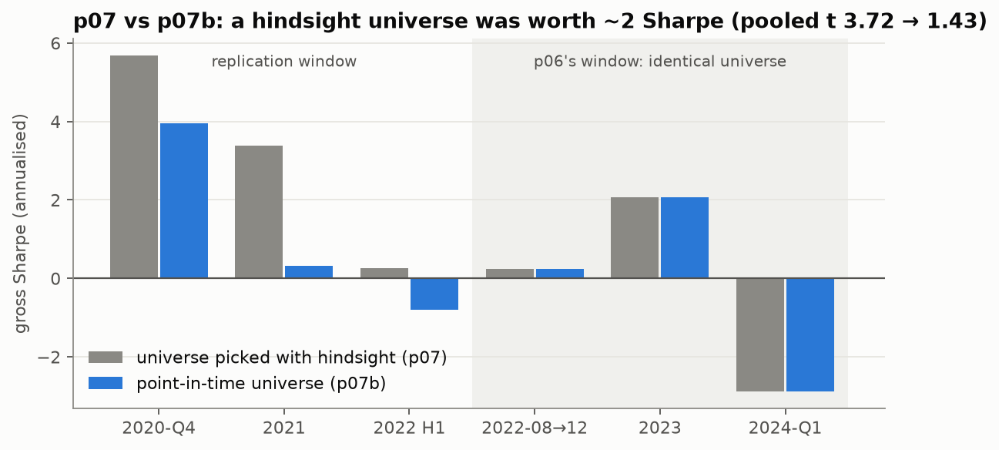
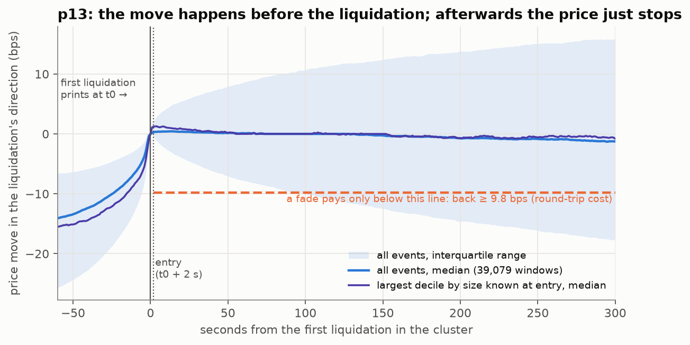
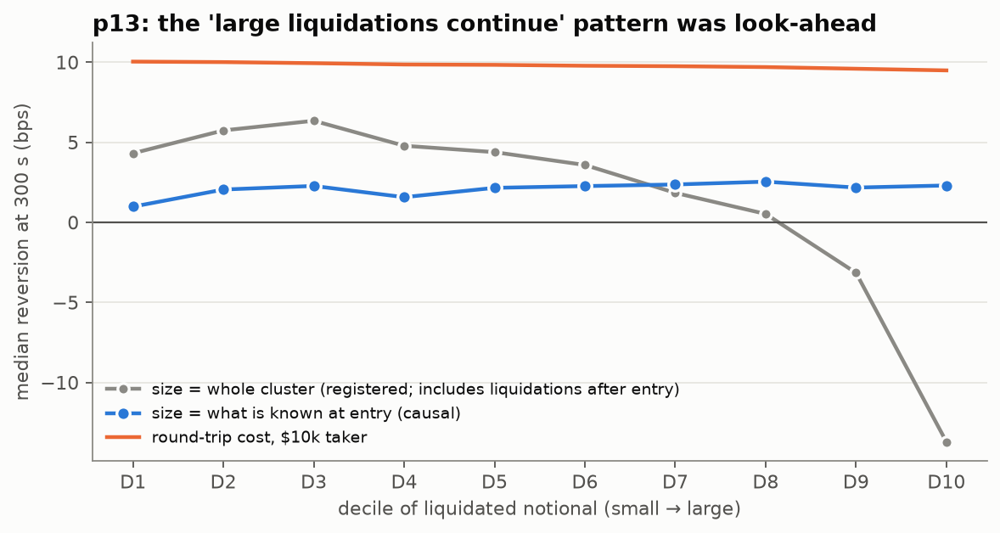

# quant-research-harness

**A validation harness for machine-learning trading research, built to be able to say "there is
nothing here", and 13 experiments on crypto markets where it did.**

Most backtests that look profitable are wrong in one of a few boring ways: labels leak through
overlapping windows, features peek at the future, costs are guessed, or the best of many tries is
reported as if it were the only one. This repo is the opposite exercise. It is a harness that catches
those failures, plus a research log that applies it honestly: every hypothesis has a kill
criterion written down before the data is read, costs are measured rather than assumed, and every
result is reviewed by an independent reviewer before it counts.

The headline result is negative, and it is the point: **no idea tested here cleared its trading
costs.** The interesting part is *how* each one failed, and how that was established.



*Blue: the cost at which each strategy breaks even (its edge per unit traded). Orange: the cost it
actually faces, measured for that market. A strategy is viable only if blue is to the right of
orange with room to spare. It never is, except where the uncertainty is larger than the gap.*

---

## Contents

- [What is in the repo](#what-is-in-the-repo)
- [The harness](#the-harness)
- [Research line 1: predicting BTC's 1h/4h direction (p01–p05, p10, p10b, p11)](#line-1-predicting-btcs-1h4h-direction)
- [Research line 2: daily cross-sectional factors (p06, p07, p07b)](#line-2-daily-cross-sectional-factors)
- [Research line 3: Polymarket 5-minute BTC markets (p08, p09)](#line-3-polymarket-5-minute-btc-markets)
- [Research line 4: forced liquidations on Hyperliquid (p12, p13)](#line-4-forced-liquidations-on-hyperliquid)
- [Ablations and robustness checks](#ablations-and-robustness-checks)
- [What generalises](#what-generalises)
- [How the research was run](#how-the-research-was-run)
- [Reproducing](#reproducing)

## What is in the repo

| | |
|---|---|
| `harness/` | the library: labels, sample weights, purged cross-validation, walk-forward backtester with costs and funding, metrics (PSR, DSR, breakeven cost), null tests, loaders |
| `selftest.py`, `tests/` | proof the harness works: it must find nothing in noise, find a planted signal, and flag a leaky feature |
| `research/pNN_*/` | one folder per experiment: `PLAN.md` (hypothesis and kill criterion, written first), code, `RESULTS.md`, `REVIEW.md` (independent review), and the raw numbers |
| `trials.json` | the trial log. Only **3** experiments ever touched the out-of-sample period; every other one was killed before it, by its own pre-registered criterion |
| `docs/` | `HARNESS.md` (harness details), `ROADMAP.md`, figures and the script that builds them |

Markets: Binance USD-M perpetual futures (15 of them), Polymarket, Hyperliquid, plus Deribit,
Bybit and OKX as external data. Data spans 2020-10 → 2026-09, all from free public archives or
self-collected; none of it is committed (tens of GB), but every download script is.

## The harness

Before any model touches real data, the harness has to pass its own test (`python selftest.py`,
synthetic GARCH bars):

| case | OOS AUC | Sharpe gross / net | what the harness says |
|---|---|---|---|
| random walk | 0.479 | −4.2 / −10.1 | no edge (shift-null p = 0.93) ✔ |
| planted weak signal | 0.533 | +8.2 / +2.1 | edge detected (p < 0.005), but *not proven after costs* (PSR 0.82) ✔ |
| leaky feature | 0.785 | +80 / +68 | look-ahead audit and implausibility alarm fire ✔ |
| naive vs purged CV on pure noise | 0.679 vs 0.488 | | naive shuffled CV invents a 0.68 AUC out of nothing ✔ |

Every result then goes through `validation_report`, a fixed gauntlet whose thresholds are never
loosened to let a result through:

1. **Look-ahead audit**: a feature with |IC| > 0.10 against the *next* bar almost certainly peeks.
2. **Implausibility alarm**: a gross Sharpe above max(4, 4 × its standard error) means find the bug.
3. **Permuted labels**: trained on shuffled labels, AUC must be ~0.5 and Sharpe ~0; otherwise the leak
   is in the plumbing.
4. **Circular-shift null**: slide the positions against returns, which keeps turnover and
   autocorrelation but destroys timing. The real Sharpe has to beat that distribution.
5. **PSR of the net Sharpe > 0.95**: makes money after costs, given how little data there is.
6. **One extra bar of delay**: if the edge dies at `delay=2`, it was bid-ask bounce.
7. **Purge probe**: naive vs purged CV AUC, to show how much of the skill is label overlap.

Other pieces that mattered: triple-barrier labels treated as *intervals* `[t0, t1]`, sample weights by
average uniqueness (1h labels on 5-minute bars overlap ~10×, so 420k labels are ~44k independent
ones), `PurgedKFold` for model selection only and `WalkForward` for anything reported, backtests that
refuse `delay=0`, perp funding in the P&L, and a deflated Sharpe ratio (DSR) that only means something
because every trial is logged. Details: [docs/HARNESS.md](docs/HARNESS.md).

---

## Line 1: predicting BTC's 1h/4h direction

**Question:** can a gradient-boosted classifier on 5-minute Binance BTC perpetual data predict the
direction of the next 1–4 hours well enough to trade? **Answer: it predicts a little, and that
little is worth less than the cost of trading it.** The line was closed after eight experiments.

| exp | what changed | best result | verdict |
|---|---|---|---|
| p01 | baseline: 15 price/volume features, 1h triple barrier, LightGBM | OOS AUC 0.528, gross Sharpe +1.04, breakeven **0.68 bps** | no timing edge beyond the null (p = 0.053); net Sharpe −7.4 |
| p02 | positions: hysteresis instead of sign + smoothing | turnover halved, breakeven **1.07 bps** | no mapping of predictions to positions reaches the 2.5 bps maker cost |
| p03 | horizon 1h → 4h, plus 25 positioning features (funding, open interest, basis, long/short ratios) | **first real timing edge** (shift-null p = 0.020), breakeven **2.50 bps** | net Sharpe 0.00 at maker cost; the new data did not help, the horizon did |
| p04 | one pooled model on 15 perps | pre-OOS breakeven **2.51 bps** | killed before OOS (line: 3.5) |
| p05 | measured costs instead of assumed ones | maker all-in **3.38 bps** (BTC), taker 5.0–7.0 | realistic costs kill the whole p01–p04 family |
| p10 | 44 trade-level order-flow features from all BTC trades (26 GB) | best breakeven **1.53 ± 0.87 bps**, and it's the model *without* flow features | killed; flow features lowered AUC (0.5445 → 0.5369) |
| p10b | how much AUC would be needed? (synthetic signal planted into the real pipeline) | a 4 bps breakeven needs **AUC 0.56–0.59** | the best real model is at 0.545: line closed |
| p11 | 26 external features: Deribit implied vol and 17.9M option trades, cross-venue funding and basis | external-only AUC **0.498** (chance); adding them *lowers* AUC by 0.021 ± 0.007 | killed on both pre-registered conditions |

**The model knows something, briefly.** The signal in the 1h predictions builds for about an hour,
stays flat to four and is gone within a day. That shape explains why holding positions for 2–5 hours
was the best any positioning rule could do:



**Positioning can't create edge that the predictions don't have.** p02 searched 32 hysteresis
rules on pre-OOS data. Each one trades off turnover against edge per trade, and none gets close to
the cost line:



**Costs had to be measured, not assumed.** p05 simulated 40,559 limit and market orders at the
exact times the p04 strategy would have traded, against real quotes and trades. Maker orders turned
out dearer than assumed: 90% fill at about 2 bps, but the 10% that don't fill have to be chased at
12–14 bps after the price has moved away. Once each asset's edge is set against its measured cost, no
asset's edge is distinguishable from zero after costs:



**How far from viable?** Instead of trying yet more features, p10b asked the inverse question: plant
a synthetic signal of known strength into the real pipeline (same labels, positions and costs) and
see what AUC a profitable model would need. The answer, 0.56–0.59 for a 4 bps breakeven, is further
from the best real model (0.545) than that model is from a coin flip:



**Why new data kept making the model worse.** p03's positioning features took 70% of the trees'
split gain but were worth almost nothing out of sample. p11's external features predicted *which
cross-validation fold a row came from* with 99.8% accuracy. Slow-moving raw levels (funding, implied
vol, basis) let the trees identify the market regime, so the model learns each regime's base rate
instead of the direction, and fails on the next regime. This became a standing rule: features enter as
ranks or trailing z-scores, and every new feature set gets this adversarial fold-id test.



## Line 2: daily cross-sectional factors

**Question:** instead of timing one asset, rank 15 perps daily on carry, basis change, reversal and
momentum, and hold the top 3 long and the bottom 3 short. **Answer: nothing passes, and the one
result that looked strong was survivorship bias.**

- **p06:** none of the four pre-registered factors reaches t ≥ 2 on 609 days. Momentum breaks even at
  21 ± 17 bps against a measured cost of 8.8 bps, so it looks economic but is not statistically
  distinguishable from zero.
- **p07:** momentum replicated on an earlier window (2020-10 → 2022-07) with t = 3.58 and a 125 bps
  breakeven. It *passed* its gate, but was not credited: the 15-asset universe had been chosen by
  2022-07 trading volume, i.e. with knowledge of which coins survived the window being tested.
- **p07b:** the same book on a universe knowable in 2020-09 drops to Sharpe +0.66 (t 0.89); pooled
  t 1.43. **The hindsight universe was worth about 2 units of Sharpe.**



## Line 3: Polymarket 5-minute BTC markets

Polymarket lists a binary market every 5 minutes on whether BTC will be up or down. A self-built
collector (Polymarket order books, Binance spot and futures websockets, Chainlink) has been running on
a cloud VM since 2026-07-25.

- **p08 (infrastructure):** reduced 261 GB of raw JSON to 6.75 GB of 1-second and 1-minute tables in
  103 minutes on one VM (16,150 units, 0 errors), with a manifest per unit. Validation against
  Binance's own trade archive showed the collector lost nothing, but the exchange feed contains
  zero-price junk prints that must be filtered.
- **p09 (fair-value model):** these markets settle on a Chainlink price stream the collector didn't
  record, so step 1 was to rebuild the settlement rule: a Binance TWAP matches Polymarket's actual
  resolutions on 96.7% of 11,958 markets (every miss within 1.5 bps of a tie). A fair-value model then
  claimed a median edge of 5.2¢ per contract, but trading it against real outcomes **loses 1.15¢ per
  contract** (t = −3.9), and Polymarket's own mid is better calibrated than the model (Brier 0.1424 vs
  0.1485). The market was smarter than the model. A settlement-feed check is parked until more data
  is recorded.

## Line 4: forced liquidations on Hyperliquid

**Thesis:** on Hyperliquid, a decentralised perpetuals exchange, every account's positions and
liquidation prices are public. Forced liquidations are orders someone *must* send regardless of
price, so be the liquidity they trade against and collect the rebound. **Answer: the rebound exists but
is about a fifth of the cost of trading it.**

- **p12 (can we see the liquidations coming?):** partly. The public API gives each account's exact
  liquidation price, but no endpoint lists all accounts. Assembling every source found (leaderboard,
  addresses from the trade stream, sub-accounts, vaults) attributes ≈ 40% of BTC open interest, and
  only 12–19% can be refreshed within a minute under the rate limits.
- **p13 (does the price come back?):** answered on history rather than by building a collector
  first. Hyperliquid's archive was reduced on a cloud VM in the same AWS region as the data, where
  reads are free: 290 GB of fills yielded 1.4M liquidations (validated 187/187 against the API),
  and 22 GB of order books gave 47,270 event windows. All of this ran on the first 75% of the history;
  the last 25% was never read.

The median path around a liquidation shows why it fails. Price moves ~14 bps in the liquidation's
direction during the minute *before* the first liquidation prints (that move is what triggered it),
and afterwards it simply stops. A fade entered 2 s later gets back a median of 0.4–2.1 bps within
5 minutes, against a 9.8 bps round-trip cost:



A trap caught in review: sorting events by their cluster's total liquidated size suggested that large
liquidations *continue* by 9–14 bps, which would be a tradeable momentum signal. But a cluster's total
size includes liquidations that happen after entry; in the top decile only 1% of the size is known
when you would trade. Sorted by what is known at entry, the pattern disappears:



---

## Ablations and robustness checks

| check | where | result |
|---|---|---|
| Horizon 1h vs 4h vs 1d | p03 | 4h best; information gone at 1d (IC 0.020, t 0.5) |
| Positioning features on / off | p03 | on: pre-OOS AUC 0.539 vs 0.543 off; OOS permutation drop 0.003 vs 0.021 for the basic set |
| Order-flow features on / off | p10 | on: AUC 0.5369 vs 0.5445 off |
| External features alone / added / off | p11 | alone 0.498; added −0.021 ± 0.007 AUC vs off |
| Asset-id feature in a pooled model | p04 | +0.0019 AUC, under the pre-set 0.002 bar; kill independent of it |
| Positioning rule (32-config grid) | p02 | best in-sample breakeven 1.35 bps vs 2.5 cost |
| Execution delay 1 → 2 → 3 bars | p01–p04 | gross edge keeps 86–100% at delay 2 (not bid-ask bounce), still not enough |
| Cost sweep 0–12 bps | p01–p03 | net Sharpe crosses zero at 0.7 / 1.1 / 2.5 bps |
| Maker vs taker, measured fills | p05 | missed fills make maker 2.6–6.7 bps, not 2.5 |
| Order size $1k → $100k | p05 | alt taker cost rises 6–19× with size |
| Hindsight vs point-in-time universe | p07 / p07b | Sharpe 2.67 → 0.66 |
| Required AUC, 3 seeds × 2 signal shapes | p10b | 0.559–0.591 for 4 bps |
| Adversarial fold-id classifier | p11 | 99.8% (external) vs 47% (basic) |
| Book cadence 0.5 s vs 5 s | p13 | killed at both |
| Event size: whole-cluster vs known at entry | p13 | continuation was look-ahead; flat when causal |
| Cost variants: exit-time book, $50k clip, maker exit | p13 | 9.8 / 10.5 / 6.4 bps; all above the ≤ 2.3 bps reversion |

## What generalises

1. **Costs decide more than the model does.** Across 13 experiments the binding constraint was never
   Sharpe; it was edge per unit traded versus cost per unit traded. When costs were measured (p05),
   the assumed ones were wrong in both directions: BTC spreads far cheaper, maker fills far dearer.
2. **Naive cross-validation lies by more than any real edge.** On overlapping labels it invented AUC
   0.68 from pure noise and inflated a real 0.538 to 0.708. Purging and embargo are not optional.
3. **Raw-level features encode the regime, not the future.** Trees love slow variables; they buy
   in-sample fit and lose out of sample. Normalise, and test with a fold-id classifier.
4. **The universe is part of the strategy.** Picking assets with today's knowledge was worth ~2
   Sharpe in a cross-sectional backtest.
5. **Size known at entry, not size known afterwards.** Event studies conditioned on the event's final
   magnitude select on the outcome.
6. **Ask what the model would need to be.** p10b's "required AUC" turned an open-ended feature search
   into a single number, and closed a research line on it.

## How the research was run

Rules that every experiment follows (they live in [CLAUDE.md](CLAUDE.md)):

- **Pre-registration.** `PLAN.md` states the hypothesis, the single change from the previous
  experiment, the selection plan and a **kill criterion**, and is committed before the data is read.
  Several results in this repo were *not* credited despite passing a threshold mechanically (p07's
  universe, p13's registered top decile), and one looser restatement of a kill rule was overruled in
  favour of the original (p05).
- **Out-of-sample data is spent once.** Selection happens on pre-OOS data with `PurgedKFold`; the
  walk-forward OOS run happens once, after review, and is logged in `trials.json` whatever the result.
  The DSR accounts for every logged trial.
- **Causality by construction.** Features use trailing windows only, bars are indexed by close time,
  snapshot data is joined strictly as-of, and a prefix-invariance test checks every feature.
- **Costs always on, and measured per venue.** Breakeven cost is reported with every result.
- **Independent review.** Each experiment is reviewed by a separate reviewer agent (see
  [.claude/agents/research-reviewer.md](.claude/agents/research-reviewer.md)) that hasn't seen the
  author's reasoning. It reads the code and outputs cold, hunts for leaks and overclaims, and writes
  `REVIEW.md`. Blocking issues are fixed before a result counts. The research loop itself is encoded
  as a command ([.claude/commands/experiment.md](.claude/commands/experiment.md)): plan, select
  pre-OOS, review, then stop at the OOS gate for a human decision.

This project was built with an AI coding assistant (Claude Code) doing much of the implementation
under these rules. The rules, the reviewer and the pre-registered kills are what keep that honest, and
the review files show where they caught real mistakes.

## Reproducing

```bash
pip install -e ".[dev]"
python tests/test_core.py            # unit tests
python selftest.py                   # must end with HARNESS OK
python docs/make_figures.py          # rebuilds every figure from committed result files
python scripts/download_binance.py --interval 5m --start 2022-01 --end 2026-08   # free history
```

Each `research/pNN_*/RESULTS.md` lists the exact commands for that experiment. Experiments that used
the self-built collector (p08, p09) or large cloud reductions (p10, p13) document their data sources
and scripts, but their raw data is not redistributable here.

## Limitations

- Everything is crypto, and mostly 2022–2026. The negative results are about these markets, horizons
  and cost levels, not about ML in trading in general.
- Costs are measured for a small retail trader (VIP0 fees, $10–50k orders). A market maker with
  rebates and co-location faces a different problem.
- Several kills are "not distinguishable from cost" rather than "certainly unprofitable"; the
  standard errors are in every table.

## License

MIT, see [LICENSE](LICENSE).
