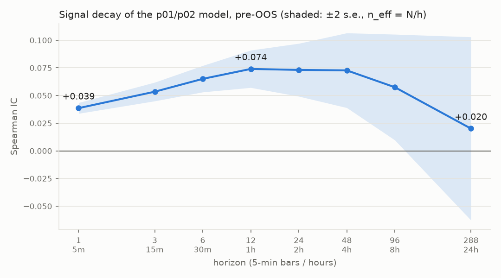

# p03 positioning features: funding, OI, basis, long/short ratios at H = 4h

**Verdict: not tradable, and the positioning data is not the reason it
improved.** At H = 48 (4h) with hysteresis, the model has the harness's
first gross timing edge that beats the shifted null (**p = 0.020**; gross
Sharpe +1.18, s.e. 0.64). It breaks even at **2.50 bps**, almost exactly the
modelled maker cost. Net Sharpe is **0.00 at maker** and -1.42 at taker, with
PSR 0.50 and DSR 0.000 (n_trials = 3).

The positioning features do not carry the edge:
- No positioning feature has |t| ≥ 2 at H = 48 or 288 pre-OOS.
- Adding them *lowered* pre-OOS AUC and gross Sharpe at both horizons.
- On OOS, shuffling all 25 of them costs 0.003 AUC, against 0.021 for the
  15 basic features, even though they take about 70% of LightGBM's gain.

The improvement over p01/p02 is most likely the longer horizon (4h vs 1h),
not the new data. That is untested on OOS; see Next.

Trial #3 in `trials.json` (`p03_positioning_H48`, maker-cost backtest).
156 pre-OOS screening rows are in `selection_trials.json`: 120 IC tests, 4
models and 32 hysteresis configs. None of them touched OOS.

Reproduce:
- `python research/p03_positioning_features/decay.py` (step 1)
- `python research/p03_positioning_features/selection.py` (steps 2–4, pre-OOS only)
- `python research/p03_positioning_features/run.py` (OOS, once)

A `--no-log` re-run of `selection.py` reproduced `selection.json` byte
for byte. `run.py` asserts that its taker, maker and importance refits
produce identical predictions.

## Setup
| | |
|---|---|
| Data | p01's perp 5m bars, plus Binance USD-M daily `metrics` (1,492 files), `premiumIndexKlines` 5m and spot BTCUSDT 5m (49 months each), and funding. 2022-08 → 2026-08, every file sha256-verified, none missing |
| New features (25) | funding level / z30d / cum 1d / cum 3d. OI change 1h/4h/1d, OI×sign(price move) 4h/1d, OI z30d. Basis (perp/spot−1, 1h mean) and z7d. Premium index 1h mean and 4h change. Top-trader account and position L/S and global L/S (log level, 4h and 1d change). Taker L/S vol ratio 1h/4h. Code: `harness.features.positioning_features` |
| Kept | `basic_features` (15), `default_model`, uniqueness weights, triple-barrier labels pt=sl=1 × `ewm_vol(288)·√H` |
| Sample | Complete rows start **2022-12-15 15:40**, because top-trader ratios are empty before 2022-12-14. 387,897 labels at H=48, **effective n 11,067** |
| Pre-OOS (selection) | label t0 **and** t1 < 2024-04-07 (1.31 years, effective n 2,860 at H=48 and 478 at H=288 for the IC tests) |
| OOS | WalkForward(8) with test blocks starting exactly at p01's OOS start, 2024-04-07 09:15 → 2026-08-31 (876 days, Sharpe s.e. ≈ 0.64). Run once. Same period as p01 and p02 |
| Chosen H | **48 (4h)**. Rule fixed before running: the higher pre-OOS PurgedKFold gross Sharpe of the full model |
| Positions | `hysteresis_position` θin = 0.05, θout = 0.025, min_hold = 48 bars (4h). Selected pre-OOS by maker net Sharpe |
| Costs | taker 5 + 0.5 bps, maker 2 + 0.5 bps, delay = 1. Funding reported separately |

## Lookahead handling
| Source | Decision | Evidence / test |
|---|---|---|
| metrics (OI, L/S ratios, taker ratio) | A row stamped T summarises the 5 min **ending** at T. It is used from the bar closing **after** T (strict asof, 30 min tolerance, no fill across gaps) | Its taker ratio matches the kline bar closing at T (median log difference 0.0006, vs 0.21 for the bar starting at T). The one-bar lag covers Binance's publication delay |
| funding | Settled rates only (the archive has no predicted rate). A rate is used from the first bar closing strictly after `calc_time`. z-score and sums are computed on the settlement series before joining | `calc_time` jitters 0–30 ms after the 8h mark. `test_funding_uses_last_settled_rate_only` |
| spot, premium index | Klines indexed by close time and joined on the exact timestamp | perp/spot return correlation is 0.997 at lag 0 and at most 0.03 at lags ±1, ±2 (`check_close_alignment`) |
| all features | Trailing windows only | `test_features_prefix_invariant`: features at t are identical whether computed from all data or from data up to t. `test_features_ignore_snapshot_stamped_at_bar_close`. Planted bugs (exact-match join, `center=True`, bfill, untoleranced ffill) are each caught |

`feature_lookahead_audit` ran on every feature pre-OOS (no suspects;
`selection.log`) and again inside validation_report (PASS below). As a
sanity check of the strict join: `taker_ls_1h` (metrics, lagged) has a
same-bar IC of -0.02, while the kline `taker_imb_1` (the bar's own flow)
has 0.72.

## Step 1: how fast the p01/p02 edge decays (pre-OOS)
Spearman IC of (prob_up − 0.5) from p02's PurgedKFold selection predictions
against the forward log return. Forward windows end by 2024-04-07. The IC
levels are optimistic: each PurgedKFold fold trains on both sides of its test
block (pre-OOS AUC 0.545 vs 0.528 walk-forward). The shape is the useful part.
t uses n_eff = N/h, which is still generous because the predictions are
persistent.



| h (bars) | horizon | IC | n_eff | t |
|---:|---|---:|---:|---:|
| 1 | 5 min | +0.039 | 168,148 | +15.8 |
| 3 | 15 min | +0.053 | 56,049 | +12.7 |
| 6 | 30 min | +0.065 | 28,024 | +10.9 |
| 12 | 1 h | +0.074 | 14,011 | +8.8 |
| 24 | 2 h | +0.073 | 7,005 | +6.1 |
| 48 | 4 h | +0.073 | 3,502 | +4.3 |
| 96 | 8 h | +0.058 | 1,751 | +2.4 |
| 288 | 24 h | +0.020 | 583 | +0.5 |

The information in the 1h model builds up over the first hour, stays flat
to about 4h, halves by 8h and is gone at 1 day. That fits the p01/p02 result
that a 2–3 hour hold was about the most these predictions could support. It
also argues that a 1-day horizon needs new information, not the old model
held longer.

## Step 4: screening (pre-OOS)
Univariate Spearman IC vs the forward log return. t = IC·√n_eff, where
n_eff = sum of uniqueness of the H-bar windows: 11,428 / 2,860 / 478 at
H = 12 / 48 / 288. |t| ≥ 2 is in bold. Slow features such as OI z-scores and
L/S levels are autocorrelated over days, so even these t-stats overstate
significance at H = 12 and 48.

| | H=12 | H=48 | H=288 |
|---|---:|---:|---:|
| positioning features with \|t\| ≥ 2 | 4 / 25 | **0 / 25** | **0 / 25** |
| basic features with \|t\| ≥ 2 | 11 / 15 | 6 / 15 | 0 / 15 |

With 25 features × 3 horizons, about 4 hits beyond |t| = 2 are expected by
chance. The 4 at H = 12 (taker_ls_1h, basis_z7d, premium_chg_4h,
top_acct_ls_chg_1d) are at that level. The basic hits are short-horizon
mean reversion (ret_12, zret_48: negative IC).

| feature | group | IC H=12 | t | IC H=48 | t | IC H=288 | t |
|---|---|---:|---:|---:|---:|---:|---:|
| ret_12 | basic | -0.0699 | **-7.48** | -0.0464 | **-2.48** | -0.0170 | -0.37 |
| zret_288 | basic | -0.0688 | **-7.35** | -0.0442 | **-2.36** | -0.0181 | -0.40 |
| zret_48 | basic | -0.0681 | **-7.28** | -0.0460 | **-2.46** | -0.0185 | -0.40 |
| ret_48 | basic | -0.0639 | **-6.83** | -0.0739 | **-3.95** | -0.0271 | -0.59 |
| ret_6 | basic | -0.0590 | **-6.30** | -0.0340 | -1.82 | -0.0123 | -0.27 |
| ret_288 | basic | -0.0404 | **-4.32** | -0.0564 | **-3.02** | -0.0653 | -1.43 |
| taker_imb_12 | basic | -0.0379 | **-4.06** | +0.0009 | +0.05 | +0.0116 | +0.25 |
| ret_1 | basic | -0.0372 | **-3.97** | -0.0172 | -0.92 | -0.0047 | -0.10 |
| taker_ls_1h | taker_ls | -0.0319 | **-3.41** | +0.0043 | +0.23 | +0.0122 | +0.27 |
| vol_48 | basic | +0.0294 | **+3.15** | +0.0396 | **+2.12** | +0.0187 | +0.41 |
| taker_imb_1 | basic | -0.0294 | **-3.14** | -0.0084 | -0.45 | +0.0014 | +0.03 |
| basis_z7d | basis_premium | -0.0256 | **-2.74** | -0.0320 | -1.71 | -0.0764 | -1.67 |
| vol_ratio | basic | +0.0250 | **+2.67** | +0.0371 | +1.98 | -0.0141 | -0.31 |
| premium_chg_4h | basis_premium | -0.0219 | **-2.34** | -0.0187 | -1.00 | -0.0161 | -0.35 |
| top_acct_ls_chg_1d | long_short | +0.0187 | **+2.00** | +0.0254 | +1.36 | +0.0089 | +0.20 |
| global_ls | long_short | -0.0186 | -1.99 | -0.0311 | -1.66 | -0.0497 | -1.09 |
| oi_px_div_1d | open_interest | +0.0182 | +1.95 | +0.0305 | +1.63 | +0.0500 | +1.09 |
| vol_288 | basic | +0.0174 | +1.86 | +0.0214 | +1.15 | +0.0455 | +0.99 |
| hour_sin | basic | -0.0170 | -1.81 | -0.0210 | -1.12 | -0.0024 | -0.05 |
| top_acct_ls | long_short | -0.0136 | -1.46 | -0.0255 | -1.36 | -0.0449 | -0.98 |
| top_acct_ls_chg_4h | long_short | +0.0119 | +1.27 | +0.0090 | +0.48 | -0.0087 | -0.19 |
| oi_px_div_4h | open_interest | +0.0038 | +0.41 | +0.0210 | +1.12 | +0.0517 | +1.13 |
| vlm_z | basic | +0.0008 | +0.08 | +0.0201 | +1.08 | -0.0058 | -0.13 |
| top_pos_ls_chg_4h | long_short | -0.0097 | -1.03 | -0.0014 | -0.07 | +0.0040 | +0.09 |
| global_ls_chg_1d | long_short | +0.0093 | +1.00 | +0.0176 | +0.94 | +0.0071 | +0.15 |
| oi_chg_1h | open_interest | -0.0081 | -0.87 | +0.0050 | +0.27 | +0.0078 | +0.17 |
| funding_cum3d | funding | +0.0077 | +0.83 | +0.0129 | +0.69 | -0.0133 | -0.29 |
| funding_z30d | funding | -0.0019 | -0.20 | -0.0065 | -0.35 | -0.0363 | -0.79 |
| oi_chg_1d | open_interest | -0.0051 | -0.54 | -0.0147 | -0.79 | -0.0328 | -0.72 |
| global_ls_chg_4h | long_short | -0.0020 | -0.22 | -0.0137 | -0.73 | -0.0159 | -0.35 |
| basis_1h | basis_premium | -0.0010 | -0.11 | -0.0009 | -0.05 | -0.0263 | -0.57 |
| taker_ls_4h | taker_ls | -0.0027 | -0.29 | +0.0105 | +0.56 | +0.0208 | +0.45 |
| funding | funding | +0.0035 | +0.38 | +0.0046 | +0.25 | -0.0253 | -0.55 |
| oi_chg_4h | open_interest | -0.0021 | -0.22 | +0.0090 | +0.48 | -0.0049 | -0.11 |
| premium_1h | basis_premium | -0.0016 | -0.17 | +0.0016 | +0.08 | -0.0204 | -0.45 |
| top_pos_ls_chg_1d | long_short | +0.0016 | +0.18 | -0.0003 | -0.02 | +0.0197 | +0.43 |
| funding_cum1d | funding | +0.0034 | +0.37 | +0.0051 | +0.27 | -0.0167 | -0.37 |
| top_pos_ls | long_short | +0.0032 | +0.34 | +0.0047 | +0.25 | -0.0095 | -0.21 |
| hour_cos | basic | +0.0016 | +0.17 | -0.0013 | -0.07 | +0.0029 | +0.06 |
| oi_z30d | open_interest | +0.0014 | +0.15 | -0.0005 | -0.03 | -0.0046 | -0.10 |

**Model-level choice of H** (PurgedKFold(5, 0.01), positions sign /
threshold 0.02 / smoothed over H). Basic-only rows are for attribution and
were not candidates:

| H | features | labels | effective n | AUC | gross SR | net SR maker | net SR taker | turnover/yr | breakeven bps |
|---:|---|---:|---:|---:|---:|---:|---:|---:|---:|
| 48 | basic | 136,974 | 3,840 | 0.543 | +2.31 | +0.73 | -1.16 | 1,906 | 3.66 |
| 48 | basic+positioning | 136,974 | 3,840 | 0.539 | +1.99 | +0.82 | -0.58 | 1,573 | 4.25 |
| 288 | basic | 136,846 | 700 | 0.508 | +0.58 | +0.25 | -0.13 | 356 | 4.48 |
| 288 | basic+positioning | 136,846 | 700 | 0.480 | -0.09 | -0.30 | -0.54 | 284 | -1.17 |

Adding positioning features lowered AUC and gross Sharpe at both horizons.
At H = 288 the full model is below chance (AUC 0.480). H = 48 wins the
pre-declared rule.

**Hysteresis for H = 48** (min_hold ∈ {4, 24, 48, 96} bars), top 8 of 32 by
the selection metric. The full grid is in `selection.json`:

| θin | θout | min_hold | gross SR | net SR maker | net SR taker | turnover/yr | breakeven bps | exposure | avg hold h |
|---:|---:|---:|---:|---:|---:|---:|---:|---:|---:|
| 0.05 (selected) | 0.025 | 48 | +2.42 | +1.13 | -0.41 | 1,906 | 4.70 | 62% | 5.7 |
| 0.05 | 0.025 | 96 | +1.85 | +1.13 | +0.27 | 1,064 | 6.45 | 59% | 9.8 |
| 0.02 | 0.0 | 48 | +2.31 | +1.07 | -0.43 | 2,096 | 4.63 | 76% | 6.4 |
| 0.01 | 0.005 | 96 | +1.70 | +0.93 | +0.01 | 1,308 | 5.52 | 77% | 10.3 |
| 0.02 | 0.01 | 96 | +1.59 | +0.84 | -0.07 | 1,175 | 5.27 | 69% | 10.3 |
| 0.03 | 0.0 | 48 | +1.93 | +0.74 | -0.69 | 1,964 | 4.05 | 73% | 6.5 |
| 0.05 | 0.0 | 48 | +1.83 | +0.73 | -0.58 | 1,738 | 4.17 | 67% | 6.7 |
| 0.05 | 0.0 | 96 | +1.35 | +0.68 | -0.12 | 1,004 | 5.07 | 62% | 10.9 |

The top two are tied on maker Sharpe (1.133 vs 1.131). The min_hold = 96
config has lower turnover and positive taker Sharpe in-sample, but the rule
picks the first, and the rule stands.

## validation_report verdict: taker (5 + 0.5 bps)
```
  OOS span                876 days (annualised Sharpe s.e. ~0.6)
  OOS AUC                 +0.521
  Sharpe gross / net      +1.184 / -1.420
  permuted labels         AUC +0.505, Sharpe +0.032 ± 0.35
  shift-null p (gross)    0.020
  PSR(net SR > 0)         0.014   breakeven cost 2.50 bps/turnover
  purge probe AUC         naive +0.708 vs purged +0.538
  Sharpe by delay (net)   d=1: -1.42, d=2: -1.52, d=3: -1.60
  Sharpe by delay (gross) d=1: +1.18, d=2: +1.08, d=3: +1.00
  Sharpe by cost (bps)    0:+1.18, 1:+0.71, 2:+0.24, 4:-0.71, 6:-1.66, 8:-2.60, 12:-4.46
  [PASS] no lookahead-looking features
  [PASS] not implausibly good (gross Sharpe < 4.0)
  [PASS] pipeline clean (permuted labels -> AUC~0.5, Sharpe~0)
  [PASS] timing edge beats shifted nulls (gross, p<0.05)
  [FAIL] net Sharpe > 0 with PSR > 0.95
  [PASS] gross edge survives 1 extra bar (d=2 keeps >50% of d=1)
```

## validation_report verdict: maker (2 + 0.5 bps)
```
  OOS span                876 days (annualised Sharpe s.e. ~0.6)
  OOS AUC                 +0.521
  Sharpe gross / net      +1.184 / -0.001
  permuted labels         AUC +0.505, Sharpe +0.032 ± 0.35
  shift-null p (gross)    0.020
  PSR(net SR > 0)         0.499   breakeven cost 2.50 bps/turnover
  purge probe AUC         naive +0.708 vs purged +0.538
  Sharpe by delay (net)   d=1: -0.00, d=2: -0.10, d=3: -0.18
  Sharpe by delay (gross) d=1: +1.18, d=2: +1.08, d=3: +1.00
  Sharpe by cost (bps)    0:+1.18, 1:+0.71, 2:+0.24, 4:-0.71, 6:-1.66, 8:-2.60, 12:-4.46
  [PASS] no lookahead-looking features
  [PASS] not implausibly good (gross Sharpe < 4.0)
  [PASS] pipeline clean (permuted labels -> AUC~0.5, Sharpe~0)
  [PASS] timing edge beats shifted nulls (gross, p<0.05)
  [FAIL] net Sharpe > 0 with PSR > 0.95
  [PASS] gross edge survives 1 extra bar (d=2 keeps >50% of d=1)
```

## vs p01 / p02 (same OOS period)
| | p01 | p02 | p03 |
|---|---:|---:|---:|
| Label horizon | 1h | 1h | 4h |
| Features | basic (15) | basic (15) | basic + positioning (40) |
| OOS AUC (labels differ by H) | 0.528 | 0.528 | 0.521 |
| Gross Sharpe | +1.04 | +0.76 | +1.18 |
| Net Sharpe, taker | -7.39 | -3.11 | -1.42 |
| Net Sharpe, maker | -2.79 | -1.01 | -0.00 |
| Turnover / yr | 4,884 | 2,419 | 1,745 |
| Breakeven (bps) | 0.68 | 1.07 | 2.50 |
| Exposure | 93% | 45% | 53% |
| Avg holding time | 2.0 h | 3.3 h | 5.4 h |
| Shift-null p (gross) | 0.053 | 0.120 | 0.020 |
| Folds with gross SR > 0 | n/a | 5 / 8 | 7 / 8 |

Other p03 numbers:
- Max drawdown is -50% at maker and -78% at taker; hit rate on active bars
  is 50.1%.
- Funding is negligible: -0.05%/yr, net Sharpe with funding -0.002 maker and
  -1.42 taker. The book is only slightly long on average (mean position +0.11).
- The purge probe shows heavy overlap leakage at H = 48: naive shuffled-KFold
  AUC is 0.708 vs 0.538 purged. That is the gap the harness exists to catch.

**Per fold** (the s.e. of a ~110-day Sharpe is about 1.8):

| fold | span | gross SR | net SR maker | exposure |
|---:|---|---:|---:|---:|
| 1 | 2024-04-07 → 2024-07-28 | +2.99 | +1.68 | 59% |
| 2 | 2024-07-28 → 2024-11-14 | +1.02 | -0.11 | 58% |
| 3 | 2024-11-14 → 2025-03-03 | +1.11 | -0.02 | 55% |
| 4 | 2025-03-03 → 2025-06-20 | +1.05 | -0.07 | 59% |
| 5 | 2025-06-20 → 2025-10-08 | +1.68 | -0.09 | 45% |
| 6 | 2025-10-08 → 2026-01-24 | -0.66 | -1.72 | 53% |
| 7 | 2026-01-24 → 2026-05-13 | +1.28 | +0.24 | 53% |
| 8 | 2026-05-13 → 2026-08-31 | +1.37 | -0.03 | 43% |

Gross Sharpe is positive in 7 of 8 folds, against 5 of 8 for p02, and there
is no late-period collapse.

## Feature importance (OOS)
Gain share is the per-fold normalised LightGBM gain, averaged over the 8
WalkForward models. The permutation AUC drop comes from jointly shuffling a
group's columns within each OOS test fold (3 shuffles) and re-scoring the
pooled OOS AUC (base 0.521).

| group | features | gain share | OOS permutation AUC drop (± sd over 3 shuffles) |
|---|---:|---:|---:|
| basic | 15 | 29.5% | +0.0207 ± 0.0009 |
| positioning | 25 | 70.5% | +0.0030 ± 0.0012 |
| pos:basis_premium | 4 | 5.9% | -0.0006 ± 0.0002 |
| pos:funding | 4 | 21.2% | +0.0011 ± 0.0002 |
| pos:long_short | 9 | 29.7% | +0.0047 ± 0.0007 |
| pos:open_interest | 6 | 12.1% | -0.0008 ± 0.0001 |
| pos:taker_ls | 2 | 1.6% | -0.0006 ± 0.0001 |

Top features by permutation drop:

| feature | group | gain share | permutation AUC drop |
|---|---|---:|---:|
| ret_288 | basic | 4.7% | +0.0140 |
| ret_48 | basic | 2.9% | +0.0075 |
| global_ls_chg_4h | long_short | 2.6% | +0.0030 |
| top_acct_ls | long_short | 4.1% | +0.0023 |
| hour_cos | basic | 3.0% | +0.0022 |
| vol_48 | basic | 3.2% | +0.0017 |
| oi_chg_1d | open_interest | 2.6% | +0.0013 |
| top_acct_ls_chg_1d | long_short | 3.2% | +0.0013 |
| vol_ratio | basic | 3.6% | +0.0010 |
| top_pos_ls_chg_4h | long_short | 2.1% | +0.0008 |
| top_pos_ls | long_short | 4.8% | +0.0008 |
| funding | funding | 4.0% | +0.0007 |

**Gain and permutation importance disagree.** The positioning features take
about 70% of the gain; funding_z30d alone is the largest single gain share at
7.4%. Yet shuffling all 25 of them on OOS costs only 0.003 AUC. Slow,
smooth features give trees easy splits that separate regimes in the training
window, but those splits don't generalise. Only the long/short-ratio group
has a drop clearly above its noise (0.0047 ± 0.0007). OI, basis/premium and
taker-ratio groups are at or below zero. The two features the model
actually relies on are `ret_288` and `ret_48` (basic). Joint group
shuffling understates importance when groups are correlated (funding ↔
basis ↔ premium), but that can't turn 0.003 into 0.021.

## Reading it
- **For the first time, the harness finds a gross timing edge.** Shift-null
  p = 0.020, the gross edge holds under delay (1.18 → 1.08 → 1.00 at
  d=1/2/3), it is positive in 7/8 folds, and the pipeline is clean
  (permuted-label Sharpe 0.03 ± 0.35). But it is 1.85 s.e. from zero, and
  this is the 3rd trial.
- **It is still not money.** Breakeven is 2.50 bps against 2.5 bps maker and
  5.5 bps taker. At maker cost this is zero before the adverse selection and
  missed fills that the backtest doesn't model, so realistically it is
  negative. It needs about 2× the edge per trade to survive taker cost.
- **Positioning data: a negative result.** At the horizons it was supposed
  to help (4h, 1d), it shows no univariate signal pre-OOS, makes the model
  worse pre-OOS, and contributes very little on OOS. The best-supported part
  is the long/short ratios, with a small but real permutation drop. Funding
  and OI look like regime descriptors the trees overfit to.
- **What probably changed is the horizon.** From p02 to p03, H went from 1h
  to 4h and min_hold from 2h to 4h. Turnover fell from 2,419 to 1,745 per
  year (4,884 in p01), and breakeven rose from 1.07 to 2.50 bps (0.68 in
  p01). Pre-OOS, basic-only at H=48 was
  *better* than the full model (AUC 0.543 vs 0.539, gross Sharpe 2.31 vs
  1.99). I have not run basic-only H=48 on OOS, so that part is inference,
  not a result.

## Next (each is a new logged trial)
- **p04 ablation: basic-only, H = 48, same hysteresis.** Nothing is selected
  on OOS; the config is fixed by p03's choices minus the positioning group.
  If it matches p03, the positioning data can be dropped from BTC 5m work.
  This is the cleanest single test of the "horizon, not data" reading.
- If the long/short ratios are worth another look: a small model with only
  basic + the 9 L/S features, chosen pre-OOS.
- Costs remain the wall. A 2.5 bps breakeven only works with maker
  execution. That makes fill modelling (queue position, adverse selection;
  the collector's order book since 2026-07-25) the next harness gap rather
  than more features.
